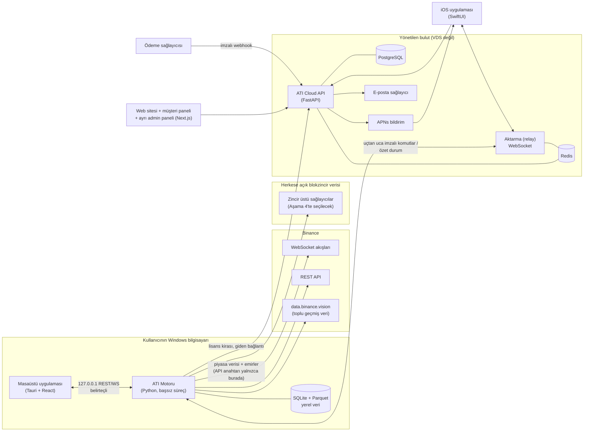
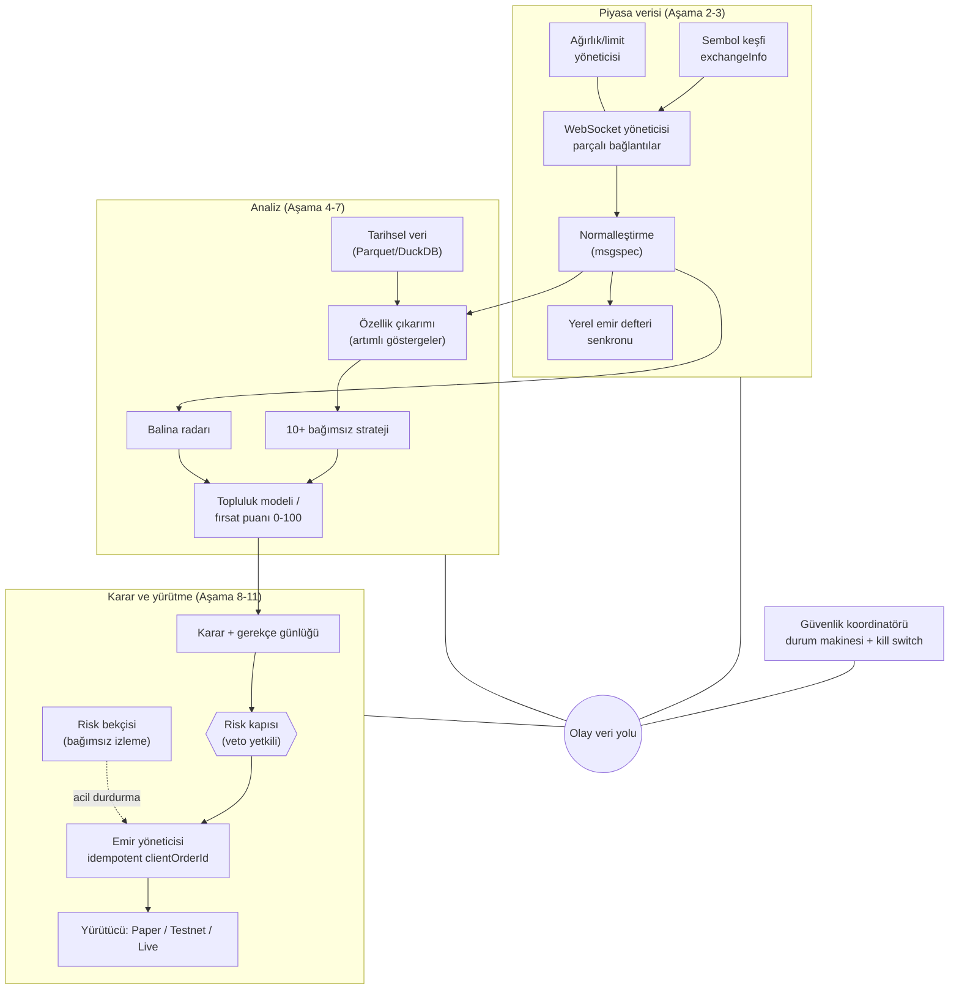
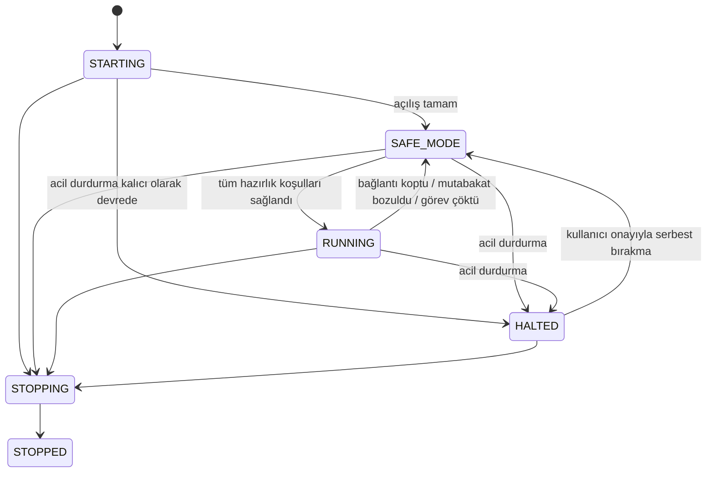
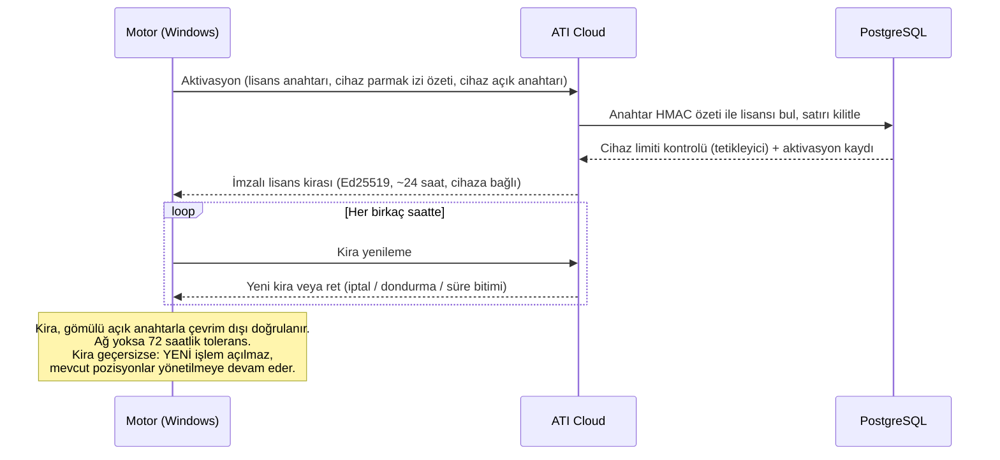

# 01 — Sistem Mimarisi

> Durum: **Aşama 1 kapsamında tasarlandı ve çekirdeği kodlandı.** Bu belge sistemin
> bütününü tanımlar; her alt sistemin ayrıntılı tasarımı ilgili aşamada genişletilecektir.

## 1. Temel ilkeler

1. **İşlem motoru kullanıcının bilgisayarında çalışır.** Kiralık VDS yoktur. Binance API
   anahtarları ve işlem verisi kullanıcının Windows bilgisayarından **hiç çıkmaz**.
2. **Bulut yalnızca merkezi işleri yapar.** Hesap, lisans, ödeme, cihaz yönetimi, iOS ↔
   masaüstü aktarması ve bildirim. Bulut hiçbir koşulda Binance'e emir gönderemez.
3. **Güvenli varsayılanlar.** Motor her açılışta sanal işlem (PAPER) modunda başlar.
   Gerçek işlem (LIVE); ayar dosyasında bilinçli olarak açılmayı, çalışma anında açık onay
   ifadesini ve bütün ön koşulların sağlanmasını gerektirir. Bu sürümde (Aşama 1) gerçek emir
   yürütücüsü olmadığından LIVE modu teknik olarak imkânsızdır.
4. **Pozisyon kapatmak her zaman serbesttir; pozisyon açmak koşula bağlıdır.** Güvenli mod,
   acil durdurma, lisans sorunu veya bağlantı kesintisi hiçbir zaman açık bir pozisyonu
   sahipsiz bırakmaz.
5. **Risk yönetimi işlem motorundan bağımsızdır.** Her emir niyeti veto yetkisine sahip risk
   kapısından geçer. Ayrıca borsa tarafında koruyucu stop emirleri bulunur.
6. **Garantili kazanç yoktur.** Sistem olasılıklara dayalı karar verir; ürünün hiçbir
   yerinde kazanç vaadi yapılmaz.

## 2. Bağlam diyagramı

## 3. Bileşenler

### 3.1 ATI Motoru (Windows, `engine/`)

Başsız bir Python süreci. Masaüstü uygulaması onu bir "sidecar" olarak başlatır ve
yalnızca `127.0.0.1` üzerindeki belirteçli yerel API ile konuşur. Motor arayüzden
bağımsızdır: arayüz kapansa da motor çalışmaya devam edebilir (sistem tepsisi modu,
Aşama 12).

**Aşama 1'de kodlanan çekirdek** (bkz. `engine/src/ati_engine/`):

| Modül | Görev |
|---|---|
| `core/bus.py` | Abone başına sınırlı kuyruk, taşma politikası (BLOCK / DROP_OLDEST / DROP_NEWEST), hata yalıtımı. Bu geliştirme ortamında ölçülen hız: tek abonede yaklaşık 720 bin olay/sn (CI test eşiği 50 bin; Windows donanımında ayrıca ölçülecek). |
| `core/models.py` | `Decimal` tabanlı alan modelleri; fiyatı tick'e, miktarı step'e kullanıcı aleyhine olmayacak yönde yuvarlama. |
| `core/supervisor.py` | Uzun ömürlü görevleri üstel geri çekilmeyle yeniden başlatır; çok sık çökerse güvenli moda geçirir. |
| `core/clock.py` | Canlı (`SystemClock`) ve geriye dönük test (`ManualClock`) için aynı arayüz. Gelecekteki veriye bakma hatasına karşı ilk önlem. |
| `safety/state.py` | Motor durum makinesi (aşağıda). |
| `safety/coordinator.py` | Hazırlık koşulları: biri bile bozulursa RUNNING → SAFE_MODE. |
| `safety/kill_switch.py` | Kalıcı acil durdurma; açık onayla kaldırılır; denetim kaydına yazılır. |
| `safety/trading_mode.py` | PAPER / TESTNET / LIVE kilidi ve ön koşul kontrolleri. |
| `security/vault.py` | Windows DPAPI (üretim) veya AES-256-GCM ile şifreli gizli bilgi kasası. |
| `security/binance_key_policy.py` | Para çekme/transfer yetkili anahtarı reddeder. |
| `security/redaction.py` | Loglarda anahtar, imza ve belirteç maskeleme. |
| `storage/` | SQLite (WAL, STRICT tablolar), özet doğrulamalı geçişler, hash zincirli denetim kaydı. |
| `api/server.py` | Yerel kontrol API'si (REST + WebSocket olay akışı). |
| `system/single_instance.py` | Aynı hesapta çift emir riskine karşı tek örnek kilidi. |
| `app.py` | Bileşim kökü, açılış/kapanış sırası, sinyal yönetimi. |

### 3.2 Motor durum makinesi

| Durum | Yeni pozisyon açma | Mevcut pozisyonu yönetme/kapatma |
|---|---|---|
| RUNNING | Evet (risk kapısından geçerse) | Evet |
| SAFE_MODE | **Hayır** | Evet |
| HALTED | **Hayır** | Evet (yalnızca azaltma) |
| STARTING / STOPPING | Hayır | Hayır (mutabakat bekleniyor) |

Hazırlık koşulları her aşamada eklenir: `market_data.*` (Aşama 2),
`exchange.<piyasa>.stream` ve `exchange.<piyasa>.reconciled` (Aşama 10-11; yürütücü bağlıyken),
`risk.daily_loss` (Aşama 11), `license.valid` (Aşama 15).

### 3.3 Masaüstü uygulaması (`desktop/`, Aşama 12)

Tauri 2 kabuğu + React/TypeScript arayüzü + TradingView Lightweight Charts. Kabuk,
motoru sidecar olarak başlatır, rastgele bir belirteç üretip `ATI_LOCAL_API_TOKEN` ortam
değişkeniyle iletir (belirteç diske yazılmaz), motoru gözetler ve kapanışta
`POST /v1/engine/shutdown` ile düzgün kapatır. Arayüz ile motor arasındaki sözleşme
`shared/protocol/engine-local-api.schema.json` dosyasıdır; TypeScript tipleri bu şemadan
üretilir ve CI şemanın koddan sapmadığını doğrular.

### 3.4 Bulut (`cloud/`, Aşama 15-17)

Kapsayıcı tabanlı yönetilen platformda (ör. Cloud Run, AWS App Runner/Fargate, Fly.io)
durumsuz FastAPI örnekleri; yönetilen PostgreSQL ve yönetilen Redis. Sorumluluklar:

* Müşteri kimlik doğrulama (Argon2id, kısa ömürlü erişim + dönen yenileme belirteçleri).
* **Ayrı** yönetici kimlik doğrulama: ayrı tablo, ayrı oturum, zorunlu TOTP 2FA, rol bazlı yetki.
* Lisans üretimi, tahsisi, aktivasyonu ve "lisans kirası" (lease) imzalama.
* Ödeme sağlayıcı webhook'ları (imza doğrulama + idempotent işleme) ve otomatik lisans teslimi.
* iOS ↔ masaüstü aktarma katmanı ve APNs bildirimleri.

### 3.5 Web (`web/`, Aşama 14) ve iOS (`ios/`, Aşama 13)

* **Web:** Next.js (App Router) + TypeScript. Tanıtım sayfaları, paketler, satın alma,
  müşteri paneli ve **ayrı alt alan adında** (`admin.`) yönetici paneli. Yasal sayfalar:
  kullanım koşulları, gizlilik (KVKK/GDPR), risk bildirimi.
* **iOS:** SwiftUI. Giriş, lisans aktivasyonu, canlı özet, bildirim merkezi, bot
  kontrolü ve acil durdurma. iOS uygulaması işlem motoru değildir; masaüstündeki motorun
  uzaktan kumandası ve izleme ekranıdır.

## 4. Binance veri motoru (Aşama 2 — uygulandı)

Gerçek ölçüm (2026-11-07): Binance Spot'ta **518** `TRADING` durumunda USDT paritesi,
USDⓈ-M Futures'ta **522** USDT sürekli kontrat (PERPETUAL) vardır. Futures'ta altın/gümüş gibi
`TRADIFI_PERPETUAL` kontratlar ve kapanmakta olan (`SETTLING`) kontratlar da listelenir; bunlar
evrenden çıkarılır. "Her şeyi en yüksek çözünürlükte izlemek" yerine **katmanlı abonelik**
uygulanır:

| Katman | Kapsam | Akışlar | Güncelleme |
|---|---|---|---|
| 0 — Pazar geneli | Tüm semboller, tek akış | Spot `!miniTicker@arr`; Futures `!ticker@arr`, `!markPrice@arr@1s`, `!forceOrder@arr` (tasfiyeler) | 1 sn |
| 1 — Tüm semboller | Her USDT paritesi | `<s>@kline_1m`, `<s>@aggTrade` (büyük işlem, alıcı/satıcı hacmi) | Gerçek zamanlı / 1-2 sn |
| 2 — Odak listesi | Ayarlanabilir semboller (Aşama 3'ten itibaren fırsat puanına göre dinamik) | `<s>@depth@100ms` + REST anlık görüntü ile yerel emir defteri | 100 ms |
| REST (zamanlanmış) | Futures | Açık pozisyon (OI), long/short oranları, taker oranı | Aşama 3-4 |

Tüm semboller izlendiğinde motor **2094 akışı 13 bağlantıda** taşır (Spot 6, Futures 7).

Doğrulanmış borsa kuralları (2026-11-07, resmi belgeler ve canlı deneme):

| Kural | Spot | USDⓈ-M Futures |
|---|---|---|
| Bağlantı başına en fazla akış | 1024 | 1024 |
| Bağlantı başına gelen mesaj limiti | 5/sn | 10/sn |
| Bağlantı ömrü | 24 saat | 24 saat |
| Sunucu ping aralığı | 20 sn | 3 dk |
| Bağlantı açma limiti | 300 / 5 dk / IP | — |
| WebSocket adresleri | Yalnızca piyasa verisi için `wss://data-stream.binance.vision` | **2026'da bölündü:** `/public` (derinlik, bookTicker) ve `/market` (işlemler, mumlar, mark price, ticker, tasfiye). Yönlendirme bu ortamda deneyle de doğrulandı. Eski `/ws` ve `/stream` adresleri 2026-04-23'te kapatıldı. |
| REST ağırlık limiti | 6000/dk | 2400/dk |

Uygulanan tasarım (`engine/src/ati_engine/exchange/`, `market/`):

* **Limitler kodda sabit değildir.** `exchangeInfo.rateLimits` okunur; her yanıttaki
  `X-MBX-USED-WEIGHT-1M` başlığı bütçeyi düzeltir (aynı IP'deki başka programların tüketimi
  de görülür). Öncelikler: arka plan işleri %60, normal istekler %80, emir/pozisyon (Aşama 10)
  %95 doluluğa kadar gönderilir. HTTP 429'da `Retry-After` süresince hiçbir istek gönderilmez;
  HTTP 418'de (IP yasağı) yasak bitene kadar REST trafiği tamamen durur.
* **Bağlantı parçalama:** Bağlantı başına en fazla 200 akış (sınır 1024); tek bir kopuşun
  etkisi küçülür. Abonelik mesajları 100'lük partiler halinde ve bağlantı başına saniyede
  en fazla 3 (Spot) / 6 (Futures) mesajla gönderilir.
* **Yeniden bağlanma:** Üstel geri çekilme + rastgele sapma; bağlantı açma denemeleri IP
  limitine karşı paylaşılan bir sınırlayıcıdan geçer. `serverShutdown` olayında beklemeden
  yeniden bağlanılır. 30 sn veri gelmeyen bağlantı ölü sayılıp yeniden açılır.
* **Kesintisiz 24 saat yenilemesi:** Ömür dolmadan önce yeni bağlantı açılır, abone olunur,
  ilk veri gelince eskisi kapatılır. Örtüşmede oluşan tekrar işlemler elenir.
* **Güvenli mod:** Herhangi bir bağlantı koptuğu anda ilgili hazırlık koşulu
  (`market_data.spot` / `market_data.usdm_futures`) bozulur ve motor SAFE_MODE'a iner;
  bağlantı düzelince RUNNING'e döner.
* **Kaçırılan işlemlerin geri alınması:** WebSocket, kopma sırasında kaçırılan mesajları tekrar
  göndermez. Motor her sembolün ardışık işlem kimliğini (`a`) izler; atlama görürse eksik
  aralığı `aggTrades?fromId=` ile REST'ten düşük öncelikle geri alır ve `recovered=True`
  işaretli olaylar olarak yayımlar.
* **Emir defteri senkronu:** Binance'in belgelediği algoritmalar birebir uygulanır (Spot:
  `U`/`u` sürekliliği; Futures: `pu` zinciri ve anlık görüntüden sonraki ilk olayın örtüşme
  koşulu). Boşluk veya çaprazlanmış defter görülünce defter atılır ve yeniden senkronlanır.
* **Masaüstüne yük bindirmeme:** Saniyede binlerce piyasa olayı yalnızca motor içinde dolaşır;
  masaüstü akışına yalnızca sistem olayları (bağlantı, listeleme, yeniden senkron) gider.
  Piyasa verisi arayüze `/v1/market/*` uç noktalarıyla sunulur.
* **Performans:** JSON çözümleme `msgspec` ile tek geçişte yapılır. Olay döngüsü gecikmesi
  sürekli ölçülür. Ölçüm darboğaz gösterirse sembol grupları ayrı süreçlere, sıcak yollar
  Rust/PyO3 modülüne taşınır.
* **Tarihsel veri (Aşama 5):** Tam geçmiş `data.binance.vision` aylık/günlük arşivlerinden
  (CHECKSUM doğrulamalı) indirilir; aradaki boşluk REST ile, canlı kısım WebSocket ile
  tamamlanır. Senkron durumu `history_sync_state` tablosundadır: **her güncellemede yalnızca
  yeni veri işlenir.**

## 5. Gecikme bütçesi (hedef 100 ms – 1 sn)

| Adım | Hedef (p99) |
|---|---|
| Binance olayı → çözülmüş model | < 5 ms |
| Model → artımlı göstergeler | < 20 ms |
| Odak sembolünde strateji değerlendirmesi | < 100 ms |
| Tüm sembollerde fırsat puanı yenileme | ≤ 1 sn |
| Karar → risk kapısı → emir gönderimi | < 50 ms (ağ hariç) |

Not: Her veri türünün borsadaki gerçek güncelleme sıklığı farklıdır (ör. ticker dizileri
1 sn, derinlik 100 ms, tasfiye anlık görüntüsü 1 sn). Motor veriyi geldiği hızda işler;
olmayan bir sıklığı varmış gibi göstermez.

## 6. VDS olmadan çalışmanın riskleri ve önlemleri

Motor kullanıcının bilgisayarında çalıştığından bilgisayar kapanabilir, uykuya geçebilir
veya internet kesilebilir. Bu riskler ürünün doğasında vardır; açıkça yönetilir:

| Risk | Önlem |
|---|---|
| Bilgisayar kapanır / çöker | Her pozisyon açılışında **borsa tarafında** koruyucu stop emri (futures: `STOP_MARKET` + `closePosition`/`reduceOnly`; spot: OCO). Motor olmasa bile zarar sınırı borsada durur. |
| Uyku modu | Motor çalışırken Windows'un uykuya geçmesi engellenir (`SetThreadExecutionState`, Aşama 12); kullanıcı uyarılır. |
| İnternet kesintisi | Hazırlık koşulu bozulur → SAFE_MODE; bağlantı dönünce önce borsa ile mutabakat, sonra RUNNING. |
| Windows güncellemesi ile yeniden başlatma | Motor açılışta kalıcı acil durdurma durumunu ve açık emir/pozisyonları borsadan okuyarak mutabakat yapar; mutabakat bitmeden yeni işlem açmaz. |
| Saat kayması | Binance `recvWindow` hatalarını önlemek için sunucu saatiyle fark ölçülür; eşik aşılırsa uyarı + SAFE_MODE. |
| Aynı hesapta iki motor | İşletim sistemi düzeyinde tek örnek kilidi; aynı API anahtarıyla ikinci cihaz için bulut tarafında uyarı (Aşama 15). |

## 7. iOS ↔ masaüstü iletişimi

Bilgisayar genellikle NAT/güvenlik duvarı arkasındadır; iOS doğrudan bağlanamaz. Bu
yüzden motor buluttaki aktarma servisine **giden** bir WebSocket bağlantısı açar; iOS da
aynı servise bağlanır.

* **Eşleştirme:** Masaüstünde QR kod gösterilir; iOS, Secure Enclave'de ürettiği P-256
  açık anahtarını motora bu kanal üzerinden iletir; motor anahtarı yerelde saklar.
* **Uçtan uca imzalı komutlar:** iOS'tan gelen her komut (`engage_kill_switch`,
  `pause_bot`, `close_position`...) cihaz anahtarıyla imzalanır; zaman damgası + artan sayaç
  ile tekrar oynatma saldırısı engellenir. Motor imzayı doğrulamadan hiçbir komutu
  uygulamaz. **Bulut ele geçirilse bile emir veremez.**
* **İzin listesi:** Uzaktan komutlar sınırlı bir listeden ibarettir. Para çekme hiçbir
  zaman yoktur; bot başlatma ve risk sınırı gevşetme gibi işlemler Face ID gerektirir.
  Acil durdurma her zaman tek dokunuştur.
* **Bildirimler:** Motor özet olayları (balina uyarısı, işlem açıldı/kapandı, acil durdurma)
  aktarma servisine gönderir; APNs bildirim içeriği hassas veri içermez.

## 8. Lisans doğrulama akışı (Aşama 15)

## 9. Ölçeklenebilirlik (binlerce müşteri)

İşlem yükü müşterilerin kendi bilgisayarlarında olduğundan bulut yükü hafiftir: kimlik
doğrulama, lisans kirası yenileme (müşteri başına saatte birkaç istek), webhook'lar ve
aktarma bağlantıları.

* API örnekleri durumsuzdur; yatay ölçeklenir. Bağlantı havuzu (PgBouncer / sağlayıcının
  havuzlayıcısı).
* Aktarma servisi: bağlantı başına hafif durum; örnekler arası mesaj yönlendirme Redis
  pub/sub ile. 10 bin eşzamanlı WebSocket birkaç küçük örnekle karşılanır.
* Hız sınırlama (Redis): giriş, aktivasyon ve lisans doğrulama uç noktalarında IP ve hesap
  bazlı.
* Lisans sayısı büyüdükçe: `licenses` tablosu `serial` üzerinden bölümlenebilir
  (partitioning); `audit_log` aylık bölümlenir.

## 10. Gözlemlenebilirlik

* Motor: JSON satır logları (`logs/engine.jsonl`, 10×10 MB döner), gizli bilgi maskeleme,
  olay döngüsü gecikmesi, veri yolu metrikleri (`/v1/status`).
* Bulut: yapılandırılmış loglar, istek kimliği, `/health` (canlılık) ve `/ready`
  (veritabanı + şema güncelliği) uç noktaları; hata izleme (Sentry vb.) ve metrikler
  (Prometheus/OpenTelemetry) Aşama 15'te eklenecek.
