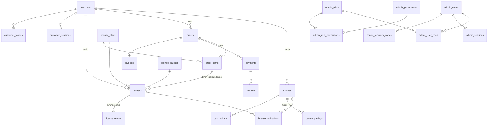
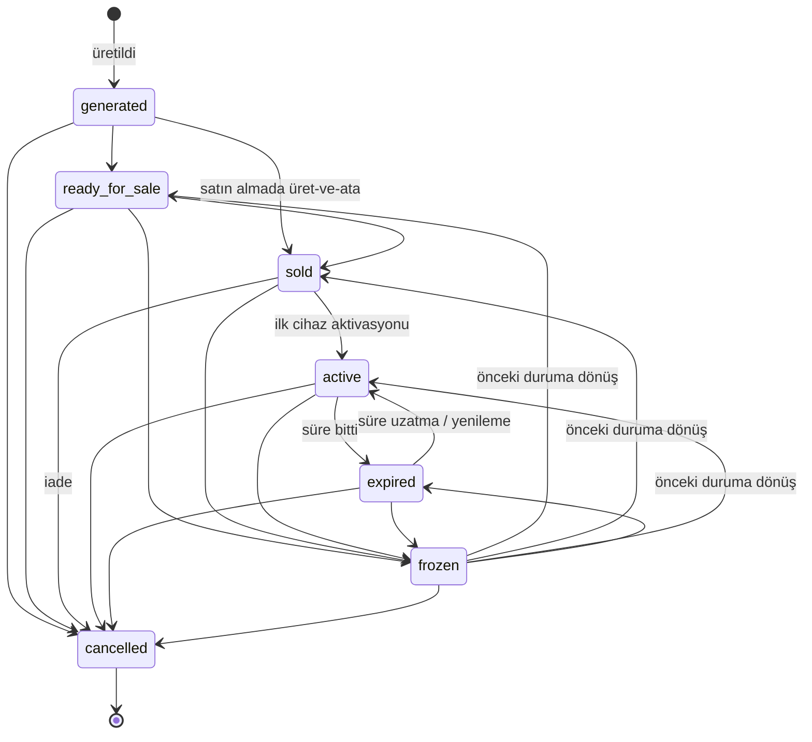

# 04 — Veritabanı Şeması

Üç depolama katmanı vardır:

| Katman | Teknoloji | Konum | Kaynak dosya |
|---|---|---|---|
| Merkezi kayıtlar | PostgreSQL 16 (yönetilen) | Bulut | `cloud/src/ati_cloud/db/migrations/*.sql` |
| Yerel işlemsel durum | SQLite (WAL, STRICT) | Kullanıcının bilgisayarı | `engine/src/ati_engine/storage/migrations/*.sql` |
| Yerel tarihsel piyasa verisi | Parquet + DuckDB | Kullanıcının bilgisayarı | Aşama 5 |

Her iki SQL şeması da **gerçek veritabanı motorunda** test edilir (bulut: 53 test,
PostgreSQL 16; yerel: SQLite).

## 1. Bulut şeması (PostgreSQL)



Ek tablolar: `payment_webhook_events`, `email_outbox`, `system_settings`, `audit_log`,
`license_status_transitions`, `schema_migrations`. Raporlama görünümleri:
`admin_license_stats`, `admin_sales_daily`, `admin_active_usage`,
`admin_effective_permissions`.

### 1.1 Veritabanında zorlanan iş kuralları

| Kural | Mekanizma | Test |
|---|---|---|
| Lisans durumları yalnızca izinli yönlerde değişir; `cancelled` son durumdur | `license_status_transitions` + `licenses_guard()` tetikleyicisi | `test_invalid_transitions_rejected`, `test_cancelled_is_terminal` |
| Aynı lisans ikinci kez satılamaz | Satılan lisans havuza dönemez; sahip bir kez atanır, değiştirilemez | `test_sold_license_cannot_be_sold_again` |
| Aynı ödeme için birden fazla lisans verilemez | `UNIQUE (order_item_id, order_item_unit)` + birim ≤ adet kontrolü; sipariş başına tek başarılı ödeme; webhook olayı tekil | `test_one_license_per_order_unit`, `test_order_has_at_most_one_successful_payment`, `test_webhook_event_is_processed_once` |
| Eşzamanlı satışlar aynı havuz lisansını alamaz | `FOR UPDATE SKIP LOCKED` deseni | `test_pool_allocation_is_race_free` |
| Cihaz limiti (Windows ve iOS ayrı) eşzamanlı isteklerde bile aşılamaz | Aktivasyon tetikleyicisi lisans satırını kilitler | `test_concurrent_activations_cannot_exceed_limit` (5 eşzamanlı istek → 1 başarı) |
| İmzası doğrulanmamış webhook işlenemez | `CHECK (processed_at IS NULL OR signature_valid)` | `test_unsigned_webhook_cannot_be_marked_processed` |
| 2FA kurulmadan yönetici aktif olamaz; yönetici oturumu en fazla 12 saat | `CHECK` kısıtları | `test_admin_cannot_be_active_without_2fa`, `test_admin_session_requires_mfa_and_short_lifetime` |
| Parolalar yalnızca Argon2id özeti olarak saklanır | `CHECK (password_hash LIKE '$argon2id$%')` | `test_password_must_be_argon2id` |
| E-posta kuyruğunda lisans anahtarı düz metin tutulamaz | `CHECK (NOT payload ?\| ARRAY['license_key',...])` | `test_email_outbox_never_stores_license_keys` |
| Denetim kaydı yalnızca eklenebilir ve hash zincirlidir | UPDATE/DELETE/TRUNCATE tetikleyicileri + `audit_log_verify()` | `test_audit_log_is_append_only`, `test_audit_tamper_detected` |
| Fiyatı girilmemiş paket satışa açılamaz | `license_plans_active_has_price` | `test_plan_cannot_be_activated_without_price` |

### 1.2 Lisans durum makinesi



| Durum (TR) | Kod |
|---|---|
| Üretilmiş | `generated` |
| Satışa hazır | `ready_for_sale` |
| Satılmış | `sold` |
| Aktif | `active` |
| Süresi dolmuş | `expired` |
| İptal edilmiş | `cancelled` |
| Dondurulmuş | `frozen` (önceki durum `status_before_freeze`'de saklanır) |

Her durum değişikliği `license_events` tablosuna; aktör bilgisi (`SET LOCAL ati.actor_type`,
`ati.actor_id`) ile birlikte otomatik yazılır.

### 1.3 Lisans anahtarı tasarımı ve 9.999.999.999 kapasite

**Biçim:** `ATI-XXXX-XXXX-XXXX-XXXX` (örnek: `ATI-7XK9-PQ82-MN45-ZR61`)

* 16 karakter, **Crockford Base32** alfabesi (32 sembol: `0-9 A-Z`, karışıklığı önlemek
  için `I L O U` yok).
* 15 karakter kriptografik rastgele (`secrets` / işletim sistemi CSPRNG) → 32¹⁵ = 2⁷⁵ ≈
  **3,78 × 10²²** olası anahtar.
* 1 karakter kontrol hanesi (Luhn mod 32): yazım hatalarını sunucuya gitmeden yakalar.

**Kapasite hesabı:**

* Gereken: 9.999.999.999 ≈ 10¹⁰ lisans. Anahtar uzayı bunun ~3,8 trilyon katı.
* 10¹⁰ anahtarın tamamı üretildiğinde *herhangi bir* çakışma olasılığı ≈ n²/2N ≈
  10²⁰ / 7,6×10²² ≈ **%0,13**. Olası tek tük çakışmayı `UNIQUE (key_hash)` yakalar ve
  anahtar yeniden üretilir.
* Tahmin saldırısı: rastgele bir denemenin geçerli bir anahtara denk gelme olasılığı
  ≈ 10¹⁰ / 3,8×10²² ≈ 2,6×10⁻¹³; ayrıca aktivasyon uç noktasında hız sınırlama vardır.
* `license_serial_seq` dizisi tam olarak **1 … 9.999.999.999** aralığındadır, `NO CYCLE`
  (test: `test_serial_sequence_capacity_is_9_999_999_999`, `test_serial_sequence_never_cycles`).

**Önceden doldurma yok:** 10¹⁰ satır × ~250 bayt ≈ 2,5 TB anlamsız depolama demektir.
Anahtarlar **ihtiyaç anında** üretilir:

1. Satın almada üret-ve-ata (`generated → sold`), veya
2. Paket başına küçük bir hazır havuz (`ready_for_sale`, ör. 100 adet) toplu üretimle
   doldurulur; satış `FOR UPDATE SKIP LOCKED` ile havuzdan alır.

**Saklama:**

| Sütun | İçerik | Amaç |
|---|---|---|
| `key_hash` | HMAC-SHA256(pepper, normalize(anahtar)) | Aktivasyonda arama; veritabanı sızsa bile anahtarlar doğrulanamaz (pepper ayrı gizli bilgi deposunda) |
| `key_ciphertext` | AES-256-GCM (KMS ile zarf şifreleme) | Müşteri panelinde anahtarı yeniden gösterme |
| `key_hint` | `ATI-****-****-****-ZR61` | Listeleme ekranları; şema tam anahtarın buraya yazılmasını engeller |

**Toplu üretim (yönetici paneli):** `license_batches` kaydı → arka plan işi 1.000'lik
parçalar halinde üretir (`COPY`) → yalnızca `license.bulk_generate` yetkili yönetici, 2FA
ile, denetim kaydına yazılarak.

### 1.4 Ödeme → lisans teslimi (idempotent akış, Aşama 17)

```text
1. Webhook gelir → imza doğrulanır (doğrulanamazsa signature_valid=false, işlenmez)
2. INSERT payment_webhook_events ... ON CONFLICT DO NOTHING   → zaten varsa dur
3. BEGIN
     payments upsert (provider_payment_id tekil; sipariş başına tek başarılı ödeme)
     orders.status = 'paid'
     her order_item için unit = 1..quantity:
        lisans = havuzdan al (SKIP LOCKED) veya üret
        UPDATE licenses SET status='sold', customer_id, order_item_id, order_item_unit
          → UNIQUE(order_item_id, order_item_unit) ikinci teslimi imkânsız kılar
     email_outbox (dedupe_key = 'license-delivery:' || order_id) → yalnızca license_id
     audit_log + orders.status = 'fulfilled'
   COMMIT
4. Webhook olayı processed_at = now()
```

İade: `refunds.license_action` = `cancel` (varsayılan) / `keep` / `manual_review`; lisans
`cancelled` olur, aktif cihazlar bir sonraki kira yenilemesinde reddedilir.

## 2. Yerel şema (SQLite)

`engine/src/ati_engine/storage/migrations/0001_initial.sql`

| Tablo | İçerik |
|---|---|
| `settings` | Kalıcı motor durumu (ör. acil durdurma) |
| `secrets` | DPAPI/AES-GCM ile şifreli gizli bilgiler (API anahtarları vb.) |
| `exchange_symbols` | Borsa kuralları (tick/step/min notional); `first_seen_at` ile yeni listelenen coin tespiti |
| `history_sync_state` | Her sembol/veri kümesi için en son işlenen zaman → artımlı güncelleme |
| `strategies` | Strateji kayıt defteri ve terfi hattı: `research → backtest → walk_forward → paper → live_candidate → live`. **`live` aşaması kullanıcı onayı kaydı olmadan veritabanı tarafından reddedilir.** |
| `strategy_metrics` | Başarı oranı, Profit Factor, Sharpe, Sortino, Maksimum Düşüş (mod ve pencere bazlı) |
| `decisions` | "Neden açıldı / neden açılmadı / hangi sinyaller / hangi strateji / neden kâr-zarar" günlüğü; risk kapısının kararı (`risk_verdict`), gerekçeleri ve ölçümleri (`risk_reasons`) |
| `orders`, `fills`, `positions` | Emir yaşam döngüsü; `mode` sütunu sanal ve gerçek kayıtların karışmasını engeller; sembol+yön başına tek açık pozisyon |
| `risk_events` | Risk kuralı tetiklenmeleri ve alınan aksiyon (kapı retleri `gate.*`, bekçi `guard.*`, mutabakat `reconcile.*`) |
| `risk_daily` | Mod ve UTC günü başına gün başı / son / en düşük özsermaye ve günlük zarar kilidi (yeniden başlatmada sıfırlanmaz) |
| `whale_events` | Balina olayları (Binance ve zincir üstü) |
| `alerts` | Bildirim merkezi |
| `audit_log` | Hash zincirli, değiştirilemez yerel denetim kaydı (`ati-engine verify-audit`) |

Kurallar: zaman damgaları epoch milisaniye, fiyat/miktar `TEXT` (Decimal hassasiyeti),
JSON alanlar `json_valid()` ile doğrulanır, tablolar `STRICT`.

## 3. Yerel tarihsel veri (Parquet + DuckDB, Aşama 5)

```text
market/klines/{market}/{interval}/symbol={SYMBOL}/year={YYYY}/month={MM}.parquet
market/agg_trades/{market}/symbol={SYMBOL}/date={YYYY-MM-DD}.parquet
```

* İlk yükleme `data.binance.vision` aylık arşivlerinden (CHECKSUM doğrulamalı), boşluklar
  REST'ten, canlı kısım WebSocket'ten.
* Güncel ay günlük dosyalarda biriktirilir, ay kapanınca tek dosyaya sıkıştırılır.
* Göstergeler artımlı hesaplanır; her yeni mumda tüm geçmiş yeniden hesaplanmaz.

## 4. Redis (bulut, planlanan anahtar alanı)

| Anahtar | Amaç | Ömür |
|---|---|---|
| `rl:{uç nokta}:{ip\|hesap}` | Hız sınırlama sayaçları | Pencere süresi |
| `relay:route:{engine_device_id}` | Motor bağlantısının hangi örnekte olduğu | Bağlantı süresi |
| `relay:chan:{customer_id}` | Örnekler arası pub/sub kanalı | — |
| `session:revoked:{jti}` | İptal edilen erişim belirteçleri | Belirteç ömrü |

Redis kalıcı kayıt tutmaz; kaybolması yalnızca geçici yeniden bağlanmaya yol açar.
